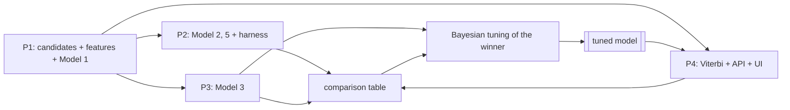

# Team plan — 4 members, one model each, 5th to P2

Read this before writing any code. Every file in the repository has exactly one
owner, so nobody overwrites anybody and there are no merge conflicts.

**Revised split:** every member owns exactly one model. The fifth model goes to P2.

---

## 1. Who owns what

| | **P1 — Data & Features** | **P2 — Models 2 & 5 + Eval** | **P3 — Model 3 + Tuning** | **P4 — Model 4 + Decoder & Serving** |
|---|---|---|---|---|
| **Model(s)** | **Model 1**<br>Multinomial Logistic Regression | **Model 2** Distance-weighted KNN<br>**Model 5** RBF SVM | **Model 3** Random Forest | **Model 4** HistGradientBoosting |
| **Model file** | `models/linear.py` | `models/instance_based.py`<br>`models/kernel.py` | `models/tree.py` | `models/boosting.py` |
| **Other owned paths** | `candidates/`<br>`features/`<br>`labels.py`<br>`viz/` (EDA map)<br>`notebooks/01_eda.ipynb` | `evaluation/cv.py`<br>`evaluation/compare.py` | `tuning/bayes.py` | `hmm/`<br>`api/`<br>`viz/` (prediction map)<br>`ui/` |
| **Report sections** | 2.2 Dataset & EDA<br>3.2 Model 1 | 3.1 comparison table<br>3.2 Models 2 & 5 | 3.2 Model 3<br>4. Bayesian optimisation | 3.2 Model 4<br>5. HMM/Viterbi<br>6. Folium<br>7. API/UI |
| **Blocks others?** | **Yes** — everything depends on it | No | No | No |

### Why the 5th model goes to P2

| Candidate owner | Load if they took it | Verdict |
|---|---|---|
| **P2** | Already owns the CV harness and the comparison table. SVM is ~5 lines of sklearn; its cost is *runtime*, not implementation. | **Chosen** |
| P3 | Owns the Bayesian optimisation stage — a full required deliverable with a search space, objective, trials record and tuned-vs-untuned comparison. Adding a second model there would unbalance. | No |
| P1 | Preprocessing is the blocking critical path; a second model would stall three people. | No |
| P4 | Owns the decoder plus the entire API/UI/deployment stack. | No |

The deciding factor is **where the measurement burden already lives**. SVM's whole
story is "excellent accuracy per parameter, poor probability calibration, worst
runtime" — which is only a credible claim if someone measures calibration and
inference cost. P2 already owns that measurement infrastructure for the comparison
table, so the model lands where the evidence is produced.

### Why each person gets that particular model

- **P1 → Logistic Regression.** Cheapest to train and the only model whose
  probability calibration matters directly to the HMM's emission term, so P1 and
  P4 need a shared understanding of it. Keeps P1's critical path clear.
- **P2 → KNN + SVM.** Both are code-light. Both have the same weakness to
  characterise honestly: coarse or Platt-scaled probabilities that feed the Viterbi
  emission term. A coherent sub-theme for one person.
- **P3 → Random Forest.** P3 owns the Bayesian search, and a tree model is the most
  likely winner, so the search and the tuned artifact stay in one pair of hands.
- **P4 → HistGradientBoosting.** Fastest strong learner and therefore the natural
  deployment model — which is the one P4 has to actually serve on evaluation day.



---

## 2. Critical path and what must be frozen early

Three things are on the critical path. Everyone else waits on them:

1. **`CandidateSet` layout** (P1) — fixed in `io/schema.py`. Do not change it.
2. **Feature schema v1** (P1) — **already written and frozen**:
   `artifacts/feature_schema.json`, 19 columns, see `docs/CONTRACTS.md` C3.
   Additive-only changes after this point.
3. **Cached feature files** (P1) — `data/processed/<partition>/<trip_id>.npz`,
   produced by `scripts/prepare_dataset.py`. P2–P4 load these; nobody regenerates
   candidates per model.

**Unblocking note:** P2–P4 do not need to sit idle. The cached matrices already
exist for all 90 local trips, so model work can start immediately:

```python
from pathsnap.features.dataset import load_partition
d = load_partition("train")            # X: 1,453,943 x 19, y, groups
X, y, groups = d.X, d.y, d.groups
```

`groups` is the trip index — pass it straight to `GroupKFold`. That is the
leakage rule enforced mechanically.

---

## 3. Sequencing

| Block | P1 | P2 | P3 | P4 |
|---|---|---|---|---|
| **1. Foundation** *(done)* | candidates, features, labels, cached matrices, quality report | CV splitter, `ModelRecord` persistence | RF class + config | HistGB class + config |
| **2. First numbers** | EDA notebook + map; **Model 1 baseline** | Model 2 + Model 5, CV + student-test | Model 3, CV + student-test | Classifier-vs-HMM scaffold on any model's proba |
| **3. Compare & tune** | feature ablation (with/without sequential block) | comparison table, `assert_five_models` | Bayesian search on the winner | Viterbi against the final model |
| **4. Ship** | prediction maps with P4 | numbers locked, §3.1 written | trials CSV, §4 written | API, UI, two-laptop test, screenshots |

**Hard gate before Block 4:** `comparison.csv` reports five models with real
numbers. If it does not, the demo has nothing to serve.

---

## 4. Definition of done — per person

### P1 — Data, features, Model 1
- [x] Candidate generation with a spatial index; miss rate measured across 80 trips
- [x] Feature schema v1 frozen; `artifacts/feature_schema.json` committed
- [x] Cached matrices for both partitions (`scripts/prepare_dataset.py`)
- [x] `experiments/results/candidate_quality.json` — miss rate 3.4% overall, 1.2% on trusted labels
- [x] EDA notebook executed end-to-end, committed with real outputs
- [x] One Folium map (network + GPS + legend) committed as HTML
- [x] Feature ablation table: geometry block vs geometry+sequential (`experiments/results/model1_ablation.csv`)
- [x] **Model 1** trained, CV + student-test numbers recorded (`experiments/results/model_logreg.json`), `describe()` filled
- [ ] Can explain the per-trip projection and why degrees-distance is invalid *(your viva answer, rehearse it)*
- [ ] Switch `scripts/run_model1.py` from sklearn GroupKFold to P2's `cross_validate_model` once `cv.py` lands

### P2 — Models 2 & 5, evaluation harness
- [x] `group_kfold` + `cross_validate_model` implemented; fold std reported
- [x] KNN and SVM satisfy `check_classifier`; unit tests green
- [x] SVM subsample size stated and justified; Platt-scaling cost measured
- [ ] `comparison.csv` + `comparison.md` generated from records, five rows
      *(4 of 5 rows present: `logreg`, `knn`, `svm_rbf`, `random_forest`;
      Person 4's HistGradientBoosting is excluded from this build by request, so
      the five-model guard reports INCOMPLETE rather than inventing a row)*
- [ ] `assert_five_models` passes *(blocked on the missing fifth record; we do not
      hand-fill it)*
- [ ] Can explain why KNN probabilities are coarse and what that costs the HMM

### P3 — Model 3, Bayesian optimisation
- [x] Random Forest satisfies `check_classifier`; importances exported
- [x] Feature importances read and interpreted (not just exported)
- [x] Optuna study with TPE sampler; objective = group-aware CV macro F1
- [x] `trials.csv` exported and committed (the required search record)
- [x] Tuned vs untuned comparison on identical partitions and metrics
- [ ] Can explain TPE, the search space, and why the objective is CV macro F1

### P4 — Model 4, decoder, serving
- [ ] HistGradientBoosting satisfies `check_classifier`; early-stopping iterations recorded
      *(outside this build by request; Person 4's `scripts/run_model4.py` and
      `experiments/results/standin_model4_loto_summary.json` are in the repo)*
- [x] Viterbi in log space; zero-candidate and disconnected steps handled
- [x] Classifier-only vs +HMM comparison including a case where it got worse
- [x] `POST /predict/{trip_id}` works for all ten reserved trips
- [ ] UI on a second laptop draws the returned route *(ran headless and against the
      live API on one laptop; the two-laptop run is the remaining manual step)*
- [x] API request logs screenshot-ready on the receiving laptop
      (`experiments/logs/api_requests.jsonl`, gitignored runtime log)

**Note on the UI:** the decoder and API are on the critical path for evaluation;
the UI is the last thing to build. Do not start it before the five models report
real numbers.

---

## 5. Viva preparation

Organisers may ask **any** member about **any** component, and "every team member
must be able to explain the code, experiments, results and conclusions". That is
where individual contribution is assessed — not commit counts.

| Question (from the brief) | Primary | Backup |
|---|---|---|
| How is the raw dataset organised? What does each file represent? | P1 | P2 |
| How did you preprocess? What features and why? | P1 | P3 |
| What were the data-quality issues and your assumptions? | P1 | P4 |
| Why did you drop some observations from training? | P1 | P2 |
| Why these five algorithms? What families do they cover? | P2 | P3 |
| Why is KNN's log loss worse than its accuracy suggests? | P2 | P1 |
| Why is the SVM not the deployed model? | P2 | P4 |
| Which model won, and what evidence justifies it? | P2 | P3 |
| What was the Bayesian search space and objective? | P3 | P2 |
| Did tuning actually help? By how much? | P3 | P2 |
| Why is tree-based boosting the deployment choice? | P4 | P3 |
| What are the hidden states and emission probabilities? | P4 | P3 |
| How are transition probabilities computed? | P4 | P2 |
| How do you handle GPS gaps and disconnected segments? | P4 | P1 |
| Did HMM improve the route? Where did it fail? | P4 | P2 |
| How does ground truth stay server-side? | P4 | P1 |
| Why can't Euclidean distance in degrees be used? | P1 | P4 |

---

## 6. Rules of engagement

- **Branches:** one branch per person, merge into `main` when tests pass. No PRs.
- **Never edit another person's owned files.** Need a change there? Ask them.
- **Frozen:** `io/schema.py`, `io/loaders.py`, `geo/distance.py`,
  `evaluation/metrics.py`, `models/base.py`, `features/build.py` (schema v1),
  `labels.py`, `features/dataset.py`.
- **Commit results, not just code.** `experiments/results/*.json|csv` are tracked
  on purpose — the report must be verifiable from the repository.
- **One authoritative CV implementation** (P2's `evaluation/cv.py`). Do not write a
  second splitter for your own model; divergent CV code is how a comparison table
  becomes fiction.
- **No secrets in git.**
