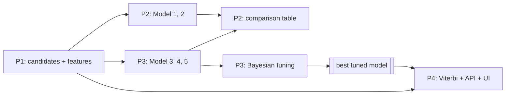

# Team plan — 4 members, 4 workstreams

Read this before writing any code. Every file in the repository has exactly one
owner, so nobody overwrites anybody and there are no merge conflicts.

---

## 1. Who owns what

| | **P1 — Data & Features** | **P2 — Models 1–2 + Eval** | **P3 — Models 3–5 + Tuning** | **P4 — Decoder & Serving** |
|---|---|---|---|---|
| **Owned paths** | `src/pathsnap/candidates/` `src/pathsnap/features/` `src/pathsnap/viz/folium_maps.py` (EDA maps) `notebooks/01_eda.ipynb` `reports/maps/eda_*.html` | `src/pathsnap/models/linear.py` `src/pathsnap/models/instance_based.py` `src/pathsnap/evaluation/cv.py` `src/pathsnap/evaluation/compare.py` | `src/pathsnap/models/tree.py` `src/pathsnap/models/boosting.py` `src/pathsnap/models/kernel.py` `src/pathsnap/tuning/bayes.py` | `src/pathsnap/hmm/` `src/pathsnap/api/` `src/pathsnap/viz/` (prediction maps) `ui/` |
| **Models built** | — (owns the features all 5 models use) | **Model 1** Logistic Regression **Model 2** Distance-weighted KNN | **Model 3** Random Forest **Model 4** HistGradientBoosting **Model 5** RBF SVM | — (owns the HMM + the system that gets demoed) |
| **Reports section** | 2.2 Dataset & EDA | 3.1 comparison table, 3.2 for Models 1–2 | 3.2 for Models 3–5, 4. Bayesian optimisation | 5. HMM/Viterbi, 6. Folium, 7. API/UI |
| **Blocks others?** | **Yes** — everything depends on it | No (uses P1's output) | No (uses P1's output) | Depends on P1 + a final model |

### Why it is split this way

P1 and P4 own no models because their components are heavier than a single
classifier: P1's feature set determines whether *any* model can work, and P4 owns
the decoder plus the two-laptop demo, which is where the evaluation actually
happens. The five required models land on P2 (2 models, both cheap) and P3
(3 models, all heavier). That is a fair 4-way split, not a 2/2/1 ranking.

---

## 2. Critical path and what must be frozen early

Three things are on the critical path. Everyone else waits on them:

1. **`CandidateSet` layout** (P1) — fixed already in `io/schema.py`. Do not change it.
2. **Feature column contract** (P1) — freeze by the end of the first work block.
   Once P1 announces "feature schema v1", P2 and P3 train against it. Feature
   additions after that are additive-only, never renames or reorders, or every
   saved model breaks.
3. **`proba` alignment with `candidates`** (P2/P3 → P4) — `proba` rows must line up
   row-for-row with `candidates.obs_idx` / `arc_id`. This is written in
   `docs/CONTRACTS.md`; if it breaks, P4's decoder silently reads the wrong arc.

**Unblocking trick:** P2 and P3 should not sit idle waiting for P1. While P1
builds features, they can write and test their model classes against a synthetic
random matrix (`np.random.rand(200, 8)`), verifying `fit`/`predict_proba`/the
contract in `models/base.py:check_classifier`. That is 30 minutes of work that
removes the block entirely.

---

## 3. Suggested sequencing (adapt to your actual time budget)

| Block | P1 | P2 | P3 | P4 |
|---|---|---|---|---|
| **1. Foundations** | `check_data.py`, EDA notebook, candidate generation, candidate miss rate | CV splitter (group-aware), metric wiring, synthetic-data smoke test of Models 1–2 | Model classes for 3–5, synthetic-data smoke test | EDA map; read the guidelines; sketch decoder math |
| **2. Freeze & train** | **Freeze feature schema v1**; EDA map committed | Train Models 1–2 on all 80 trips, CV + student-test | Train Models 3–5, CV + student-test | Implement Viterbi against *any* model's proba (use P2's logreg) |
| **3. Compare & tune** | Feature ablations (which features actually help) | Comparison table + `assert_five_models` | Bayesian optimisation on the winning model; tuned vs untuned | Classifier-only vs +HMM comparison, negative cases |
| **4. Ship** | Prediction maps with P4 | Numbers locked, report section 3 written | Trials CSV exported, section 4 written | API, UI, two-laptop test, screenshots |

**Hard gate before Block 4:** `python -m pathsnap.evaluation.compare` must report
five models with real numbers. If it does not, the demo has nothing to serve.

---

## 4. Definition of done — per person

Each person is done when **all** of these are true:

### P1 — Data & Features
- [ ] `python scripts/check_data.py` runs clean on all 90 local trips
- [ ] Candidate generation works on all 80 train trips; candidate miss rate reported
- [ ] `feature_schema.json` written and committed; column order frozen
- [ ] Feature ablations: at least one table showing "with/without" a feature group
- [ ] EDA notebook executed end-to-end (no stale outputs) and committed
- [ ] At least one Folium map with network + GPS + legend, committed as HTML
- [ ] Can explain the projection choice and why degrees-distance is wrong

### P2 — Models 1–2 + evaluation
- [ ] Both models satisfy `check_classifier`; unit tests pass
- [ ] Group-aware CV implemented; fold-to-fold std reported, not just the mean
- [ ] `experiments/results/model_logreg.json` and `model_knn.json` committed
- [ ] `comparison.csv` generated from records, all five rows filled
- [ ] `assert_five_models` passes
- [ ] Can explain why KNN's probability estimates are coarse and what that costs the HMM

### P3 — Models 3–5 + tuning
- [ ] Three models satisfy `check_classifier`; unit tests pass
- [ ] RF feature importances exported; `hist_gb` iteration count recorded
- [ ] SVM training/inference time measured and compared honestly against RF
- [ ] Optuna study runs; `trials.csv` exported and committed
- [ ] Tuned vs untuned comparison on the same data partitions and metrics
- [ ] Can explain TPE sampling, the search space, and why the objective is CV macro F1

### P4 — Decoder & serving
- [ ] Viterbi implemented in log space; handles zero-candidate and disconnected steps
- [ ] Classifier-only vs +HMM comparison table, including a case where it got worse
- [ ] `POST /predict/{trip_id}` works for all ten reserved trips
- [ ] UI on a second laptop fetches the trip list, calls the API, draws the route
- [ ] API logs visible and screenshot-worthy on the receiving laptop
- [ ] Prediction Folium map with all layers committed

---

## 5. Viva preparation

The brief is explicit: organisers may ask **any** member about **any** component,
and "every team member must be able to explain the code, experiments, results and
conclusions". Contribution is judged there, not by commit counts.

Before the demo, each person should be able to answer their own questions cold,
**and** have a one-line answer for the others' so nobody freezes:

| Question (from the brief) | Primary | Backup |
|---|---|---|
| How is the raw dataset organised? What does each file represent? | P1 | P2 |
| How did you preprocess? What features and why? | P1 | P3 |
| What were the data-quality issues and your assumptions? | P1 | P4 |
| Why these five algorithms? What families do they cover? | P2 | P3 |
| Why is KNN's log loss worse than its accuracy suggests? | P2 | P3 |
| Which model won, and what evidence justifies it? | P2 | P3 |
| What was the Bayesian search space and objective? | P3 | P2 |
| Did tuning actually help? By how much? | P3 | P2 |
| What are the hidden states and emission probabilities? | P4 | P3 |
| How are transition probabilities computed? | P4 | P1 |
| How do you handle GPS gaps and disconnected segments? | P4 | P1 |
| Did HMM improve the route? Where did it fail? | P4 | P2 |
| How does ground truth stay server-side? | P4 | P1 |
| Why can't Euclidean distance in degrees be used? | P1 | P4 |

---

## 6. Rules of engagement

- **Branches:** one branch per person, merge into `main` when tests pass. No PRs,
  no approvals — the brief does not ask for them.
- **Never edit another person's owned files.** Need a change there? Ask them.
- **`io/schema.py`, `io/loaders.py`, `geo/distance.py`, `evaluation/metrics.py`
  are frozen.** They are the shared contract; changes break everyone.
- **Commit your own work under your own git identity** (`docs/SETUP.md`).
- **Commit results, not just code.** `experiments/results/*.json` and `*.csv` are
  tracked on purpose — the report must be verifiable from the repo.
- **No secrets in git.** No API keys, no passwords, no tokens, no `.env`.
